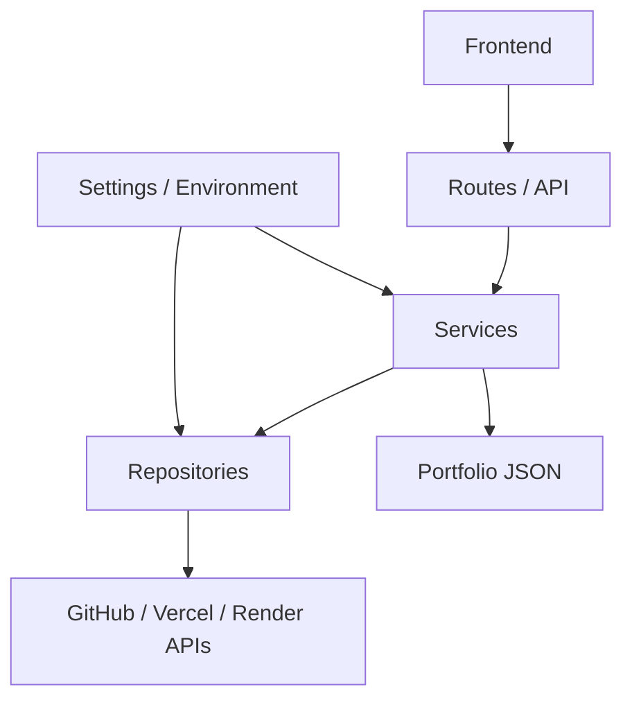

<div align="center">

# ⚙️ Portfolio Backend API

### Python · FastAPI · GitHub · Vercel · Render

<p>
  
  
  
  
</p>

</div>

---

## 📌 Descripción

API REST del portfolio profesional. Centraliza el contenido editorial y las integraciones con GitHub, Vercel y Render. La arquitectura separa rutas, servicios, repositorios y configuración para facilitar mantenimiento, pruebas y futuras ampliaciones.

## 🧱 Arquitectura



## 📂 Estructura

```text
app/
├── main.py
├── api/
│   ├── router.py
│   └── routes/
│       ├── health.py
│       ├── portfolio.py
│       ├── github.py
│       ├── vercel.py
│       └── render.py
├── core/
│   ├── config.py
│   └── http_client.py
├── data/
│   └── portfolio.json
├── repositories/
│   ├── portfolio_repository.py
│   ├── github_repository.py
│   ├── vercel_repository.py
│   └── render_repository.py
├── schemas/
│   ├── health.py
│   └── deployments.py
└── services/
    ├── portfolio_service.py
    ├── github_service.py
    ├── vercel_service.py
    └── render_service.py
```

## 🚀 Instalación local

```bash
python -m venv .venv
```

Windows:

```bash
.venv\Scripts\activate
```

Instalar dependencias:

```bash
pip install -r requirements.txt
```

Crear `.env` a partir de `.env.example` y completar las credenciales. Luego:

```bash
uvicorn app.main:app --reload
```

- API: `http://127.0.0.1:8000`
- Swagger UI: `http://127.0.0.1:8000/docs`
- Health: `http://127.0.0.1:8000/api/health`

## 🔐 Variables de entorno

| Variable | Descripción |
|---|---|
| `APP_NAME` | Nombre del servicio |
| `APP_VERSION` | Versión de la API |
| `GITHUB_USER` | Usuario de GitHub |
| `VERCEL_TOKEN` | Token de la API de Vercel |
| `VERCEL_TEAM_ID` | Equipo de Vercel, si corresponde |
| `RENDER_API_KEY` | API key de Render |
| `ALLOWED_ORIGINS` | Orígenes del frontend separados por comas |

No subas `.env` ni credenciales al repositorio. En producción, definí estas variables en el panel del proveedor.

## 🔌 Endpoints

| Método | Ruta | Descripción |
|---|---|---|
| GET | `/api/health` | Estado de la API |
| GET | `/api/portfolio` | Contenido editorial |
| GET | `/api/github/repos` | Repositorios públicos propios |
| GET | `/api/vercel/deployments` | Último deployment de producción por proyecto |
| GET | `/api/render/deployments` | Servicios de Render, con paginación |

## ☁️ Render

Comando de inicio recomendado para este layout:

```bash
uvicorn app.main:app --host 0.0.0.0 --port $PORT
```

Configurá las variables de entorno en Render y agregá el dominio del frontend a `ALLOWED_ORIGINS`.

## 🧩 Responsabilidad por capa

- **Routes:** validan la entrada HTTP y exponen endpoints.
- **Services:** implementan casos de uso y traducen errores a respuestas HTTP.
- **Repositories:** realizan llamadas a APIs externas o leen los datos persistidos.
- **Core:** centraliza configuración compartida.
- **Schemas:** define modelos de respuesta cuando corresponde.
- **Data:** mantiene el contenido editorial separado del código.

## ⚠️ Notas

- La estructura conserva las rutas públicas existentes.
- El contenido de `portfolio.json` se extrajo de la función original sin reescribir los textos.
- Los proveedores externos pueden cambiar sus APIs; revisar sus permisos y respuestas si una integración falla.
